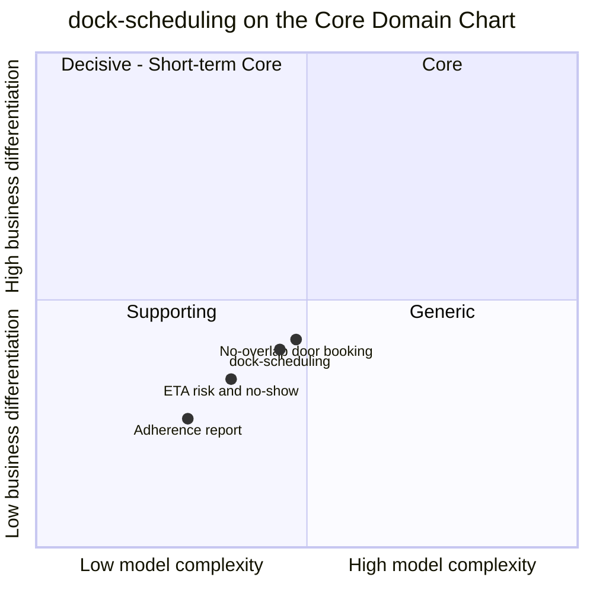

# Core Domain Chart

Following the ddd-crew [Core Domain Charts](https://github.com/ddd-crew/core-domain-charts):
business differentiation (y) against model complexity (x).

Source: `internal/domain/dockappointment/appointment.go`, `internal/domain/dockappointment/commands.go`, `internal/domain/dockappointment/events.go`, `internal/domain/dockcalendar/calendar.go`, `internal/domain/dockcalendar/events.go`, `internal/application/usecases/facts.go`, `internal/application/usecases/yard.go`, `internal/application/usecases/change.go`, `internal/application/ports/ports.go`, `migrations/0001_dock_scheduling.up.sql`.

Omitted: the other contexts (their points are on their own charts). The three
internal slices are this page's reading of the design model, not values from
the yard design model; all of them stay in quadrant 3.

## Classification: Supporting

The context point sits in **quadrant 3 (Supporting)**: below and left of the
centre. The design model classifies it `Supporting`, business model *Cost reducer
(carrier wait, detention, idle dock labour) and revenue protector (on-time
inbound)*.

**Differentiation is moderate to low (y = 0.40).** The design model's roles are
Specification (the door calendar), Gateway for carriers (Open Host Service)
and Analysis (adherence). The calendar is needed by every site that has doors,
and the fleet does not win by how it books a door. What it protects is a
cost, carrier wait and idle dock labour, and the on-time arrival of inbound
stock. The highest slice is the no-overlap door booking, because it is the
one rule that two organisations (carriers and the site) both feel when it
fails.

**Model complexity is moderate (x = 0.45).** Two aggregates (`DockAppointment`
with five states and ten transitions, `DockCalendar` with a single state),
sixteen invariants and ten policies. The hard parts are cross-cutting more
than structural: one rule over a door's whole calendar under a per-door
advisory lock, four checks against event-fed copies (doors, ASNs, cutoffs and
the calendar itself), and physical facts that arrive out of order from
`yard-management`. The adherence report is plain counting and plotted lowest.

## Evolution

The design model sets the context's evolution stage to **Product**. The slices below
are this page's reading.

| Part | Evolution stage (reading) | Why |
| --- | --- | --- |
| No-overlap door booking and calendar | **Product** | The design model puts the context at this stage; a product could replace it if it published the same events and honoured the same invariants. |
| Applying yard facts (`ArrivalFromGate`, `ActualDoorWins`, `OutOfOrderYardFacts`) | **Custom-built** | Specific to the fleet's two-context split between the future and the present of a door. |
| ETA risk and no-show sweep | **Custom-built** | Small rules over the site's own tolerance and grace settings. |
| Plumbing (outbox, inbox, CloudEvents) | **Commodity** | The same building blocks as every context (`conventions.integration_rules`). |

**Movement to watch.** The design model names a future context,
`transport-visibility`, that would feed `ReportEta` with real-time ETAs.
Nothing in the design model makes ETA risk more than an advisory today (nothing
reschedules automatically), so the slice stays Supporting; if an ETA feed
started to drive rescheduling, the ETA slice would move up and right. The
industry basis for these placements is on [benchmarks](https://iqvo.github.io/warehouse-docs/yard/research/benchmarks).
