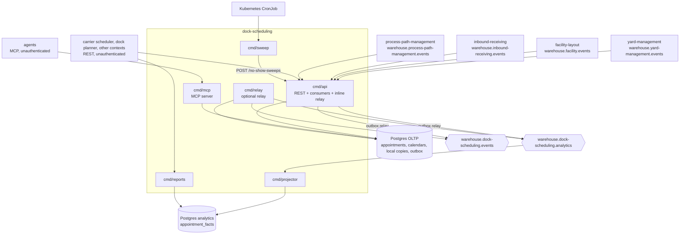

# Architecture

`dock-scheduling` follows the fleet's hexagonal layout: dependencies point inward, the domain imports nothing from the rest of the module, and only `cmd/` wires the layers together. The rules are enforced by `TestHexagonalArchitecture` and its siblings in `internal/architecture`.

Source: `internal/`, `cmd/`, `migrations/`, `analytics/migrations/`, `charts/dock-scheduling/`.

## Layout

| Layer | Path | Role |
| --- | --- | --- |
| Domain | `internal/domain/dockappointment` | `DockAppointment` aggregate: states, `Window`, `Eta`, `Arrival`, commands (`Book`, `Reschedule`, `Cancel`, `ReportEta`, arrival, door reassignment, release, no-show, legacy import), `DoorSchedule` overlap check and the domain events. |
| Domain | `internal/domain/dockcalendar` | `DockCalendar` aggregate (one per site): `Settings`, operating hours, closures, free/busy availability, the calendar events. |
| Domain | `internal/domain/shared` | Value objects: `DoorCode`, `SiteID`, `Carrier` (name and SCAC), `Direction`, `DockFlow`. |
| Application | `internal/application/usecases` | The `Service`: commands (`book.go`, `change.go`, `calendar.go`), queries (`queries.go`), the Kafka-driven fact use cases (`facts.go`, `yard.go`), the idempotent write wrapper and the `Initiator` attribution (`initiator.go`). |
| Application | `internal/application/ports` | Out ports: `AppointmentRepo`, `CalendarRepo`, `DoorView`, `AsnView`, `CutoffView`, `ProcessedEvents`, `IdempotencyStore`, `EventPublisher`, `Metrics`, `IDGen`, `Clock`, `UnitOfWork`, `AdherenceReader`, `FreshnessReader`. |
| Application | `internal/application/views`, `repository`, `outbox` | Read models returned to adapters, filters and paging records, and the already-encoded outbox `Row`/fact types. |
| Inbound adapter | `internal/adapters/inbound/http` | chi router for `apis/openapi.yaml`: handlers, RFC 7807 problems (`errors.go`), `Idempotency-Key` middleware, ETag/`If-Match`, `/healthz`, `/readyz`, `/metrics`; plus the reports router for `apis/openapi-reports.yaml`. No auth middleware. |
| Inbound adapter | `internal/adapters/inbound/kafka` | The yard, facility, ASN, CPT and legacy-import consumers and the analytics consumer: CloudEvents decode, dispatch on the full `type`, retry with backoff, dead-letter topic. Decode only; every effect is a use case. |
| Inbound adapter | `internal/adapters/inbound/mcp` | MCP server (Streamable HTTP): five read tools, four write tools, one resource and prompts, authority levels. |
| Outbound adapter | `internal/adapters/outbound/postgres` | pgx repositories, unit of work (`pgtx`), outbox publisher and store, idempotency store, embedded migrations. |
| Outbound adapter | `internal/adapters/outbound/analyticsstore` | The analytical database: writer `Projection`, read-only `Reader`, its own migrations. |
| Outbound adapter | `internal/adapters/outbound/outbox` | The relay loop that drains the outbox to a handler. |
| Outbound adapter | `internal/adapters/outbound/kafka` | CloudEvents encoder (ADR 0004 catalogue), `RelaySink`, writers (acks=all, no fixed topic), `BrokerCheck` for `/readyz`. |
| Outbound adapter | `internal/adapters/outbound/telemetry`, `system` | Prometheus metrics; the production `Clock` and ID generator. |
| Outbound adapter | `internal/adapters/outbound/memory` | In-memory implementation of every port: a **test double**. No `cmd/` imports it (`TestRuntimeBinaryHasNoInMemoryAdapters`). |
| Kafka envelope | `internal/adapters/kafka/cloudevents` | The only place a CloudEvents 1.0 envelope is built or decoded. `Repo = "dock-scheduling"`, `Subdomain = "wms"`, `Source = "/warehouse/dock-scheduling"`. |
| Support | `internal/bootretry`, `internal/config` | Boot retry for the first dials; shared env parsing for the outbox knobs, brokers, drain delay. |
| Test support | `internal/testing/{kafkatest,pgtest,repocontract}` | Testcontainers helpers and the repository contract suite run against both the memory and Postgres adapters. |
| Fitness tests | `internal/architecture` | Source-scanning and dependency tests (see [Testing](/docs/development/testing)). |

## Binaries and ports

All six binaries are built into one image (`Dockerfile` loops over `cmd/*`).

| Binary | Role | Port | Probes |
| --- | --- | --- | --- |
| `cmd/api` | REST API, in-process outbox relay and the four Kafka consumers (plus the optional legacy importer), all always on, on real Postgres and Kafka. | `HTTP_ADDR`, default `:8080` | `GET /healthz`, `GET /readyz` (Postgres ping and a Kafka metadata request), `GET /metrics` |
| `cmd/mcp` | MCP server, Streamable HTTP, over the same use cases; no relay, no consumer. Serves `/mcp` and `/`. | `MCP_ADDR`, default `:8090` | `GET /healthz`, `GET /readyz`, `GET /metrics` |
| `cmd/projector` | The only writer of the analytical database: consumes `warehouse.dock-scheduling.analytics`; exits non-zero if its consumer stops. | `ADMIN_ADDR`, default `:8091` | `GET /healthz`, `GET /readyz` |
| `cmd/reports` | Read-only HTTP reader of the analytical database: `/reports/schedule-adherence`, `/reports/freshness`. | `HTTP_ADDR`, default `:8092` | `GET /healthz`, `GET /readyz`, `GET /metrics` |
| `cmd/relay` | Optional stand-alone outbox relay (same loop as the api's). No migrations. | `ADMIN_ADDR`, default `:8094` | `GET /healthz` |
| `cmd/sweep` | One-shot CronJob entrypoint: POSTs `/no-show-sweeps` with retry, then asks the sidecar to quit. | none | exit code |

There is no `cmd/a2a`: this service has no A2A server. Variables per binary are in [Configuration](/docs/operations/configuration); boot and shutdown order in the [Runbook](/docs/operations/runbook).

## Container diagram

Source: `cmd/api/main.go`, `cmd/mcp/main.go`, `cmd/projector/main.go`, `cmd/reports/main.go`, `cmd/relay/main.go`, `cmd/sweep/main.go`, `charts/dock-scheduling/templates/`.

## Data stores

| Store | Owner | Contents |
| --- | --- | --- |
| Postgres OLTP (`DATABASE_URL`) | `cmd/api` (writer), `cmd/mcp`, `cmd/relay` (outbox only) | Aggregates: `dock_appointments`, `asn_claims`, `dock_calendars`, `calendar_operating_hours`, `calendar_closures`. Local copies: `zones`, `doors`, `asns`, `cutoff_schedules`, `cutoffs`. Plumbing: `processed_events` (consumer dedupe), `outbox`, `idempotency_keys`. Migrations in `migrations/`, applied at boot by `cmd/api` and `cmd/mcp`. |
| Postgres analytics (`ANALYTICS_DATABASE_URL`) | `cmd/projector` (the only writer), `cmd/reports` (read-only) | `analytics_processed_events`, `appointment_facts`. Migrations in `analytics/migrations/`, applied by the projector. |
| Kafka (one broker platform-wide) | outbox relay (producer), consumers | Topics listed in the [Runbook](/docs/operations/runbook). |

Delivery is at-least-once with an atomic effect: every consumer claims the CloudEvents id in `processed_events` inside the same transaction as its effect, and every aggregate change writes its outbox rows in the same transaction as the aggregate. See [ADR 0005](/docs/adr/0005-postgres-persistence-and-outbox), [ADR 0006](/docs/adr/0006-analytics-read-side) and [ADR 0009](/docs/adr/0009-kafka-consumers).
